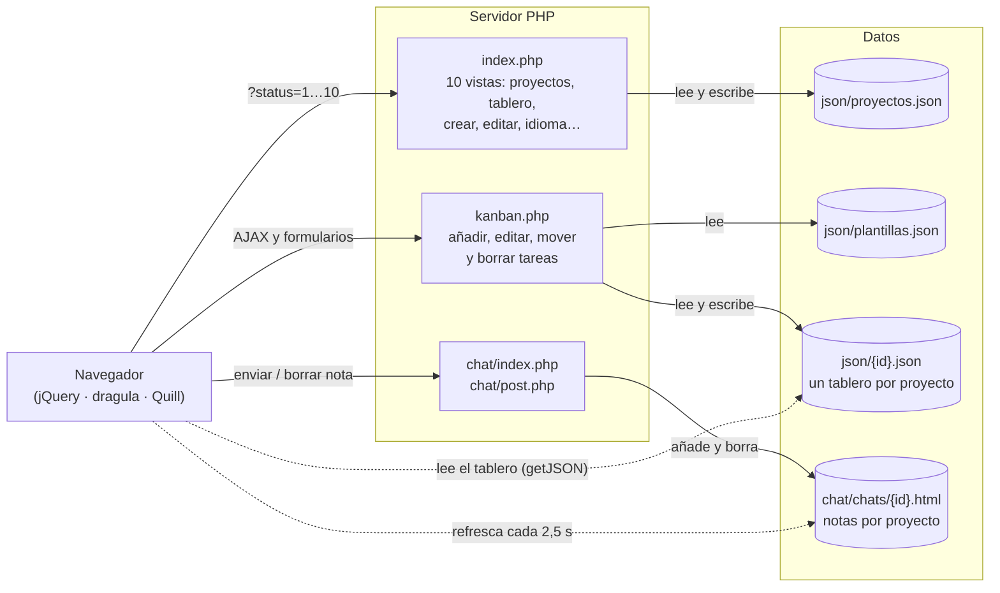
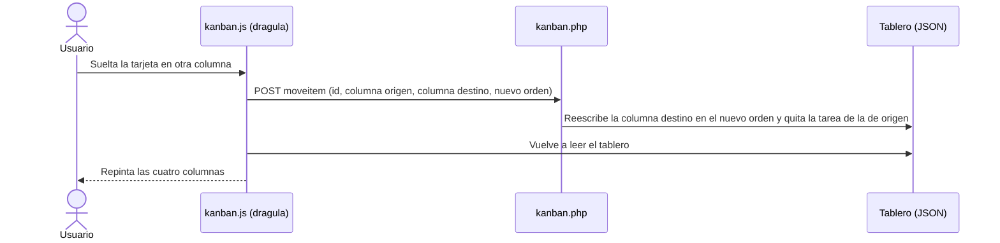

<p align="center">
  
</p>

<h1 align="center">Kanban por proyectos</h1>

<p align="center">
  <a href="README.md">English</a> · <strong>Español</strong>
</p>

<p align="center">
  Aplicación web para organizar el trabajo de un equipo en <strong>tableros kanban por proyecto</strong>, con plantillas de tareas, editor de texto enriquecido, un chat de notas para cada proyecto y la interfaz en <strong>tres idiomas</strong>.<br>
  Hecha con <strong>PHP y JavaScript, sin frameworks de backend y sin base de datos</strong>.
</p>

<p align="center">
  
  
  
  
  
</p>

<p align="center">
  
</p>

---

## Índice

- [Qué es](#qué-es)
- [Funcionalidades](#funcionalidades)
- [Pruébalo en un minuto](#pruébalo-en-un-minuto)
- [Cómo funciona por dentro](#cómo-funciona-por-dentro)
- [Estructura del proyecto](#estructura-del-proyecto)
- [Lo que aprendí y lo que haría hoy](#lo-que-aprendí-y-lo-que-haría-hoy)
- [Contexto](#contexto)
- [Créditos](#créditos)

## Qué es

Cada proyecto tiene su propio tablero de cuatro columnas, con los nombres que tú elijas («Pendiente → Diseño → Desarrollo → Publicado», «Nueva → URGENTE → En proceso → Finalizado»…), y su propio bloc de notas compartido. Las tareas se crean desde plantillas, se escriben con formato y se mueven arrastrándolas. Al mover o borrar una tarea, el cambio se guarda al momento sin recargar la página.

Es una aplicación completa, de la interfaz al almacenamiento: **PHP** en el servidor, **JavaScript y jQuery** en el navegador, y los datos en ficheros **JSON y HTML** con un formato propio.

## Funcionalidades

### 🗂️ Gestión de proyectos
- Crear proyectos con nombre, descripción y **cuatro columnas personalizadas**.
- Editar proyectos y marcar uno como **proyecto por defecto**, que es el que se abre al entrar.
- **Deshabilitar sin borrar**: el proyecto desaparece de la lista principal, pero se conservan su tablero y sus notas, y se puede consultar en la vista de todos los proyectos.

| Lista de proyectos | Todos los proyectos (activos e inactivos) |
|---|---|
|  |  |

### 📋 Tablero kanban
- **Arrastrar y soltar** tareas entre columnas, o dentro de una misma columna para reordenarlas, con [dragula](https://github.com/bevacqua/dragula). Cada movimiento se guarda por **AJAX**.
- **Papelera**: suelta una tarea en la esquina superior derecha para borrarla.
- Cada tarjeta muestra título, fecha de creación y descripción. Los guiones (`-`) de la descripción se convierten en párrafos.


### ✍️ Tareas con plantillas y texto enriquecido
- El editor **[Quill](https://quilljs.com/)** permite negrita, cursiva, subrayado, tachado, subíndice y superíndice, listas y sangrías.
- **Plantillas** reutilizables: «Incidencia», «Reunión», «Mejora»… Se definen en `json/plantillas.json` y se cargan en el editor con un clic.


### 💬 Chat de notas por proyecto
- Cada proyecto tiene su propio canal de notas, que **se actualiza solo cada 2,5 segundos**.
- Las notas se pueden **copiar al portapapeles** o **borrar** con un clic.


### 🌍 Interfaz en tres idiomas
- Español, inglés y francés, con un clic en las banderas.
- Los textos están en `idiomas/*.json`. Para añadir otro idioma basta con un fichero nuevo, sin tocar código.


## Pruébalo en un minuto

Necesitas **PHP 7.4 o superior** (probado con PHP 8.3) y conexión a internet, porque algunas librerías se cargan desde CDN.

```bash
git clone https://github.com/RafaelAMunozDev/kanban-proyectos.git
cd kanban-proyectos
php -S localhost:8000
```

Abre <http://localhost:8000>.

¿No tienes PHP? Con **Docker** funciona igual:

```bash
docker run --rm -p 8000:8000 -v "$PWD":/app -w /app php:8.3-cli php -S 0.0.0.0:8000
```

> En Windows puedes instalar PHP con `winget install PHP.PHP.8.3`.

El repositorio trae **tres proyectos de ejemplo con datos inventados**: «General», «Web Tienda» e «Inventario», este último deshabilitado. La aplicación escribe en `json/` y `chat/chats/`, así que esas carpetas necesitan permisos de escritura. Para volver a los datos de ejemplo después de probar:

```bash
git checkout -- json chat/chats && git clean -f json chat/chats
```

## Cómo funciona por dentro

### Arquitectura

No hay framework de backend ni base de datos; Bootstrap y Bulma se usan solo para los estilos. Cada pantalla es una **vista** dentro de `index.php` o `kanban.php`, y se elige con el parámetro `?status=` de la URL. El navegador lee los ficheros de datos directamente y PHP se encarga de escribirlos.



Todas las vistas cargan sus textos de `idiomas/<idioma>.json` según el idioma guardado en la sesión.

### Qué pasa al arrastrar una tarea



### Modelo de datos

**Proyectos** (`json/proyectos.json`). Cada proyecto apunta a su tablero y a su fichero de notas. Las cuatro columnas se guardan en un único texto separado por `#`:

```json
{
  "id": "4127516866012",
  "proyecto": "Web Tienda",
  "description": "Rediseño tienda online",
  "kanbanjson": "4127516866012.json",
  "chathtml": "4127516866012.html",
  "columnas": "Pendiente#Diseño#Desarrollo#Publicado",
  "pordefecto": "off",
  "estado": "activo"
}
```

**Tablero** (`json/<id>.json`). Las columnas 1 a 4 corresponden a las claves `idea`, `todo`, `deliver` y `review`:

```json
{
  "idea":    [{ "id": "061413052264", "title": "Buscador", "description": "<p>Añadir un buscador…</p>", "date_string": "14/Jun" }],
  "todo":    [],
  "deliver": [],
  "review":  []
}
```

**Notas** (`chat/chats/<id>.html`). Cada nota es un fragmento HTML con su fecha y sus botones de copiar y borrar. `post.php` añade notas al final del fichero y borra la línea que contiene el id de la nota.

**Idioma**: se guarda en la sesión de PHP, y cada vista carga los textos de `idiomas/<idioma>.json`.

## Estructura del proyecto

```
├── index.php            Vistas de proyectos y tablero (?status=1…10)
├── kanban.php           Tareas: formularios y acciones AJAX (?status=1…5)
├── kanban.js            Tablero en el navegador: dragula, ids, fechas y llamadas AJAX
├── json/
│   ├── proyectos.json   Lista de proyectos
│   ├── plantillas.json  Plantillas de tareas
│   └── <id>.json        Un tablero por proyecto
├── chat/
│   ├── index.php        Pantalla de notas (se refresca cada 2,5 s)
│   ├── post.php         Enviar y borrar notas
│   └── chats/<id>.html  Notas de cada proyecto
├── idiomas/             es.json · en.json · fr.json
├── css/                 kanban.css + Bootstrap 3
├── images/              Iconos, logo y banderas
├── quilljs-textarea-master/   Integración de Quill con <textarea>
└── capturas/            Imágenes de este README
```

## Lo que aprendí y lo que haría hoy

Con este proyecto aprendí a construir una aplicación web completa desde cero:
- separar lo que hace el servidor de lo que hace el navegador;
- guardar datos sin base de datos;
- comunicar ambas partes por AJAX;
- integrar librerías de terceros (dragula, Quill y un chat de código abierto) adaptándolas a lo que necesitaba;
- preparar una interfaz para varios idiomas.

Si lo hiciera hoy, cambiaría sobre todo esto:

- **Base de datos** (por ejemplo SQLite) en lugar de reescribir ficheros JSON completos. Así se evitan pérdidas si dos personas guardan a la vez.
- **Seguridad**: escapar todo lo que se muestra (`htmlspecialchars`), validar las entradas, añadir protección CSRF y usuarios con contraseña. Ahora mismo **no está pensado para exponerse a internet**.
- **No pasar datos por la URL**: al editar una tarea, la descripción viaja en la URL. Hoy la pediría al servidor por su id.
- **Separar vistas y lógica**: en lugar de un `index.php` con diez vistas, una plantilla por pantalla y un pequeño enrutador.
- **JavaScript moderno**: `fetch` en vez de jQuery, y repintar solo la tarjeta que cambia en vez de todo el tablero.

## Contexto

Hice este proyecto en 2023, durante mis prácticas del ciclo de SMR (Sistemas Microinformáticos y Redes), y lo programé sin ayuda de IA.

Lo publico prácticamente tal como estaba, porque refleja cómo programaba entonces. Para subirlo solo he hecho lo mínimo:

- He quitado las referencias a la empresa donde hice las prácticas.
- He sustituido los datos reales por datos de ejemplo inventados.
- He borrado archivos de librerías que no se usaban.
- He pasado al español algunos comentarios que estaban en inglés.
- He traducido cuatro textos que se habían quedado fijos en español y he corregido la pista de las columnas, que decía «separadas por comas» cuando se separan con `#`.
- He corregido el enlace al chat (`./chat` → `./chat/`). Sin la barra final, con `php -S` el chat se quedaba sin estilos y no podía enviar notas.
- He corregido cuatro detalles que impedían que funcionara en PHP 8:
  - claves de array sin comillas;
  - una coma sobrante en `idiomas/en.json`;
  - un `session_start()` en el chat que iba después de enviar HTML;
  - un `header()` en `kanban.php` que también iba después de enviar HTML.

## Créditos

- **`chat/`** es una adaptación de [minchat](https://github.com/YunoHost-Apps/minchat_ynh) (licencia MIT, © 2015 Chtixof). Minchat, a su vez, se basa en [wojtek77/chat](https://github.com/wojtek77/chat) y en un tutorial de Tuts+. Su licencia está en [`chat/LICENSE`](chat/LICENSE).
- **[Quill](https://quilljs.com/)** es una librería de terceros (licencia BSD-3-Clause). Se carga desde su CDN; `quilljs-textarea-master/quill.snow.css` es su hoja de estilos.
- **[quilljs-textarea](https://github.com/tangien/quilljs-textarea)** es una librería de terceros (licencia MIT, © 2019 Dinesh Kumar). Está en `quilljs-textarea-master/`, con su licencia en [`quilljs-textarea-master/LICENSE`](quilljs-textarea-master/LICENSE).
- Otras librerías de terceros: [Bootstrap 3.3.5](https://getbootstrap.com/) (MIT, incluida en `css/bootstrap.css`), [Bulma](https://bulma.io/) (MIT), [jQuery](https://jquery.com/) (MIT), [dragula](https://github.com/bevacqua/dragula) (MIT) y [Font Awesome 4](https://fontawesome.com/v4/). Todas salvo Bootstrap se cargan desde CDN.
- Las banderas de `images/` son de [flag-icons](https://github.com/lipis/flag-icons) (MIT).
