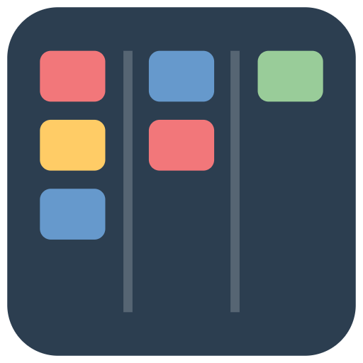
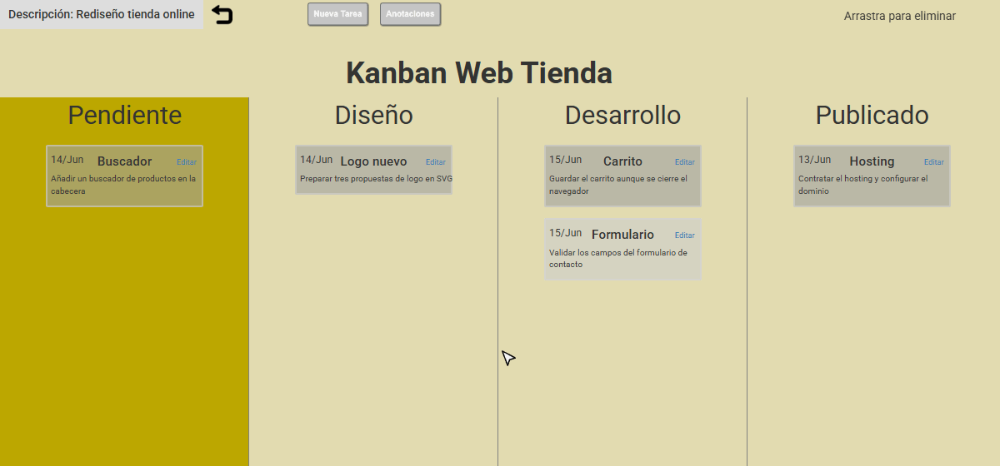
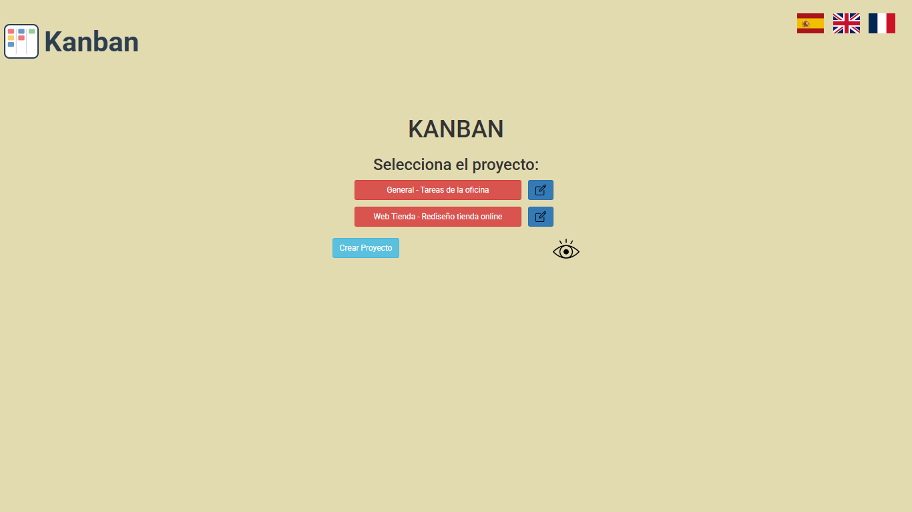
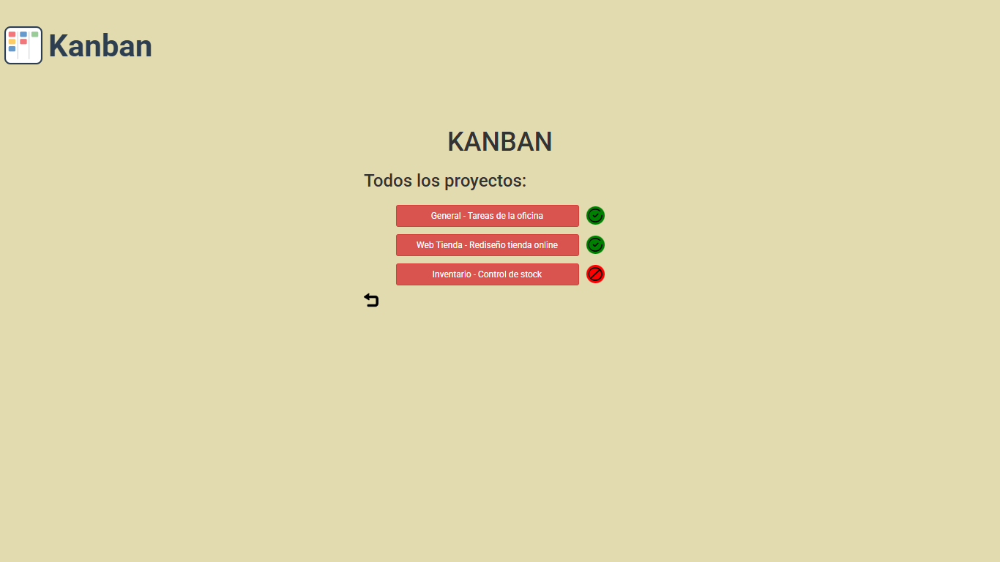
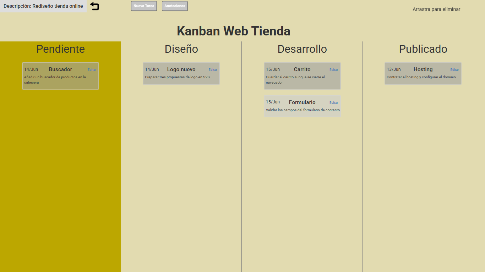
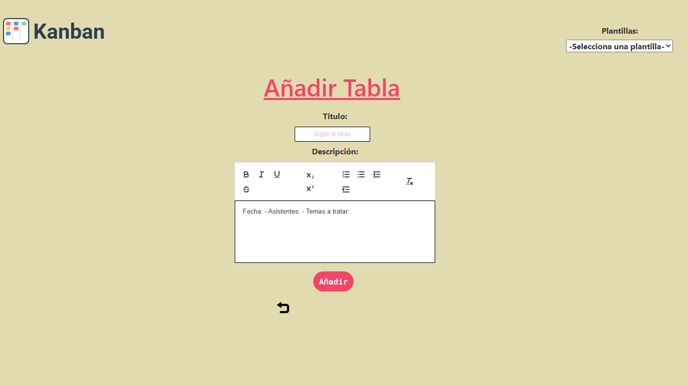
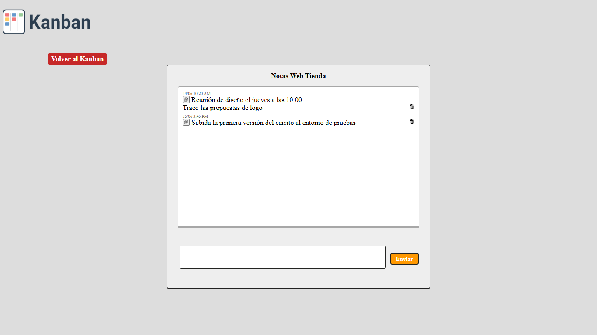
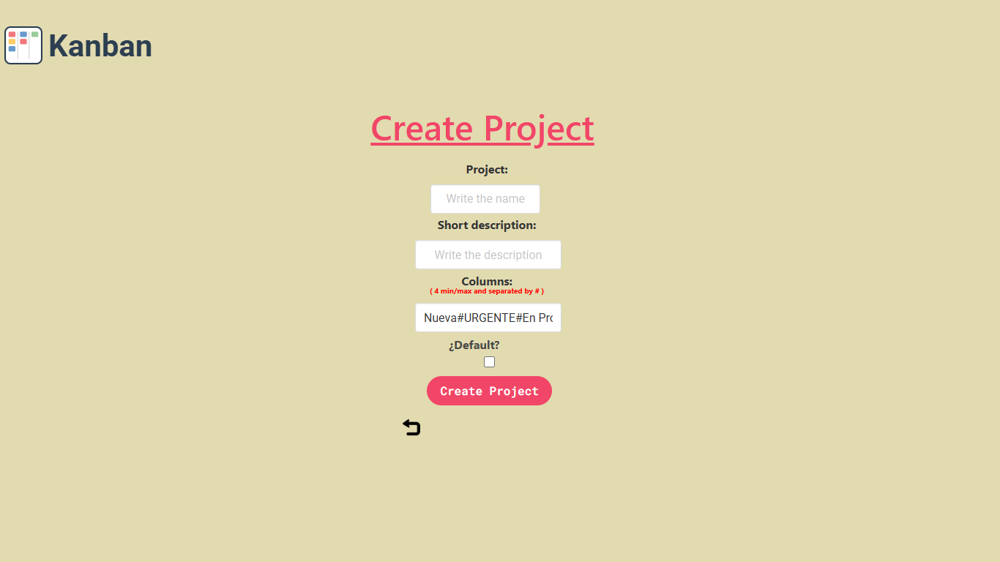
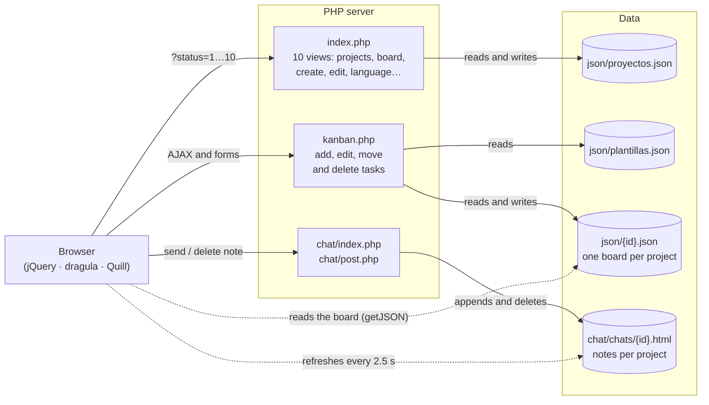
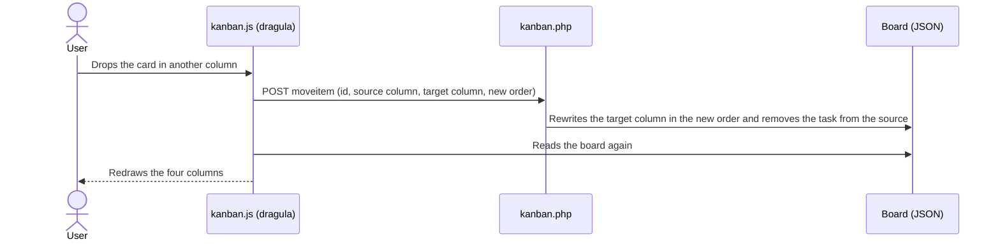

<p align="center">
  
</p>

<h1 align="center">Kanban por proyectos</h1>

<p align="center">
  <strong>English</strong> · <a href="README.es.md">Español</a>
</p>

<p align="center">
  A web app for organizing a team's work on <strong>per-project kanban boards</strong>, with task templates, a rich-text editor, a notes chat for each project and a user interface in <strong>three languages</strong>.<br>
  Built with <strong>PHP and JavaScript, with no backend framework and no database</strong>.
</p>

<p align="center">
  
  
  
  
  
</p>

<p align="center">
  
</p>

---

## Contents

- [What it is](#what-it-is)
- [Features](#features)
- [Try it in one minute](#try-it-in-one-minute)
- [How it works](#how-it-works)
- [Project structure](#project-structure)
- [What I learned and what I would do today](#what-i-learned-and-what-i-would-do-today)
- [Background](#background)
- [Credits](#credits)

## What it is

Each project has its own four-column board with the column names you choose ("Pendiente → Diseño → Desarrollo → Publicado", "Nueva → URGENTE → En proceso → Finalizado"…) and its own shared notepad. Tasks are created from templates, written with formatting and moved by dragging them. When you move or delete a task, the change is saved immediately without reloading the page.

It is a complete application, from the interface to storage: **PHP** on the server, **JavaScript and jQuery** in the browser, and the data in **JSON and HTML** files with a custom format.

> The app's default language, the sample data and the code comments are in Spanish, because I built it during an internship in Spain. The interface can be switched to English or French with one click.

## Features

### 🗂️ Project management
- Create projects with a name, a description and **four custom columns**.
- Edit projects and mark one as the **default project**, which is the one that opens when you start the app.
- **Disable without deleting**: the project disappears from the main list, but its board and notes are kept, and it is still available in the all-projects view.

| Project list | All projects (active and inactive) |
|---|---|
|  |  |

### 📋 Kanban board
- **Drag and drop** tasks between columns, or within the same column to reorder them, using [dragula](https://github.com/bevacqua/dragula). Every move is saved over **AJAX**.
- **Trash area**: drop a task in the top right corner to delete it.
- Each card shows the title, the creation date and the description. Dashes (`-`) in the description become separate paragraphs.



### ✍️ Tasks with templates and rich text
- The **[Quill](https://quilljs.com/)** editor supports bold, italic, underline, strikethrough, subscript and superscript, lists and indentation.
- Reusable **templates** such as "Incidencia" (issue), "Reunión" (meeting) and "Mejora" (improvement). They are defined in `json/plantillas.json` and load into the editor with one click.



### 💬 Notes chat for each project
- Each project has its own notes channel, which **refreshes automatically every 2.5 seconds**.
- Notes can be **copied to the clipboard** or **deleted** with one click.



### 🌍 Interface in three languages
- Spanish, English and French, switched by clicking the flags.
- The texts live in `idiomas/*.json`. Adding another language only takes a new file, with no code changes.



## Try it in one minute

You need **PHP 7.4 or later** (tested with PHP 8.3) and an internet connection, because some libraries are loaded from a CDN.

```bash
git clone https://github.com/RafaelAMunozDev/kanban-proyectos.git
cd kanban-proyectos
php -S localhost:8000
```

Open <http://localhost:8000>.

No PHP? It works the same with **Docker**:

```bash
docker run --rm -p 8000:8000 -v "$PWD":/app -w /app php:8.3-cli php -S 0.0.0.0:8000
```

> On Windows you can install PHP with `winget install PHP.PHP.8.3`.

The repository includes **three sample projects with made-up data**: "General", "Web Tienda" and "Inventario" (the last one disabled). The app writes to `json/` and `chat/chats/`, so those folders need write permissions. To go back to the sample data after trying it:

```bash
git checkout -- json chat/chats && git clean -f json chat/chats
```

## How it works

### Architecture

There is no backend framework and no database; Bootstrap and Bulma are only used for styling. Each screen is a **view** inside `index.php` or `kanban.php`, selected with the `?status=` URL parameter. The browser reads the data files directly and PHP takes care of writing them.



Every view loads its texts from `idiomas/<language>.json`, based on the language stored in the session.

### What happens when you drag a task



### Data model

**Projects** (`json/proyectos.json`). Each project points to its board and its notes file. The four columns are stored as a single string separated by `#`:

```json
{
  "id": "4127516866012",
  "proyecto": "Web Tienda",
  "description": "Rediseño tienda online",
  "kanbanjson": "4127516866012.json",
  "chathtml": "4127516866012.html",
  "columnas": "Pendiente#Diseño#Desarrollo#Publicado",
  "pordefecto": "off",
  "estado": "activo"
}
```

**Board** (`json/<id>.json`). Columns 1 to 4 map to the keys `idea`, `todo`, `deliver` and `review`:

```json
{
  "idea":    [{ "id": "061413052264", "title": "Buscador", "description": "<p>Añadir un buscador…</p>", "date_string": "14/Jun" }],
  "todo":    [],
  "deliver": [],
  "review":  []
}
```

**Notes** (`chat/chats/<id>.html`). Each note is an HTML fragment with its date and its copy and delete buttons. `post.php` appends notes to the end of the file and deletes the line that contains the note's id.

**Language**: stored in the PHP session; each view loads its texts from `idiomas/<language>.json`.

## Project structure

```
├── index.php            Project and board views (?status=1…10)
├── kanban.php           Tasks: forms and AJAX actions (?status=1…5)
├── kanban.js            Board in the browser: dragula, ids, dates and AJAX calls
├── json/
│   ├── proyectos.json   Project list
│   ├── plantillas.json  Task templates
│   └── <id>.json        One board per project
├── chat/
│   ├── index.php        Notes screen (refreshes every 2.5 s)
│   ├── post.php         Send and delete notes
│   └── chats/<id>.html  Notes for each project
├── idiomas/             es.json · en.json · fr.json
├── css/                 kanban.css + Bootstrap 3
├── images/              Icons, logo and flags
├── quilljs-textarea-master/   Quill integration with <textarea>
└── capturas/            Images used in this README
```

## What I learned and what I would do today

With this project I learned to build a complete web application from scratch:
- separating what the server does from what the browser does;
- storing data without a database;
- connecting both sides with AJAX;
- integrating third-party libraries (dragula, Quill and an open-source chat) and adapting them to what I needed;
- preparing an interface for several languages.

If I built it today, these are the main things I would change:

- **A database** (SQLite, for example) instead of rewriting whole JSON files. That avoids losing data when two people save at the same time.
- **Security**: escape everything that is displayed (`htmlspecialchars`), validate input, add CSRF protection and user accounts with passwords. Right now it is **not meant to be exposed to the internet**.
- **No data in the URL**: when editing a task, its description travels in the URL. Today I would load it from the server by its id.
- **Separate views and logic**: instead of one `index.php` with ten views, one template per screen and a small router.
- **Modern JavaScript**: `fetch` instead of jQuery, and redrawing only the card that changes instead of the whole board.

## Background

I built this project in 2023, during the internship of my SMR vocational training (Sistemas Microinformáticos y Redes, a Spanish IT qualification), and I wrote it without AI help.

I am publishing it almost exactly as it was, because it shows how I programmed back then. To upload it I only made minimal changes:

- I removed the references to the company where I did the internship.
- I replaced the real data with made-up sample data.
- I deleted library files that were not used.
- I translated into Spanish a few code comments that were in English.
- I translated four texts that were hard-coded in Spanish and fixed the columns hint, which said "separated by commas" when they are separated with `#`.
- I fixed the link to the chat (`./chat` → `./chat/`). Without the trailing slash, under `php -S` the chat loaded without styles and could not send notes.
- I fixed four details that stopped it from working on PHP 8:
  - unquoted array keys;
  - a trailing comma in `idiomas/en.json`;
  - a `session_start()` in the chat that came after HTML had been sent;
  - a `header()` in `kanban.php` that also came after HTML had been sent.

## Credits

- **`chat/`** is an adaptation of [minchat](https://github.com/YunoHost-Apps/minchat_ynh) (MIT license, © 2015 Chtixof). Minchat is in turn based on [wojtek77/chat](https://github.com/wojtek77/chat) and a Tuts+ tutorial. Its license is in [`chat/LICENSE`](chat/LICENSE).
- **[Quill](https://quilljs.com/)** is a third-party library (BSD-3-Clause license). It is loaded from its CDN; `quilljs-textarea-master/quill.snow.css` is its stylesheet.
- **[quilljs-textarea](https://github.com/tangien/quilljs-textarea)** is a third-party library (MIT license, © 2019 Dinesh Kumar). It lives in `quilljs-textarea-master/`, with its license in [`quilljs-textarea-master/LICENSE`](quilljs-textarea-master/LICENSE).
- Other third-party libraries: [Bootstrap 3.3.5](https://getbootstrap.com/) (MIT, included in `css/bootstrap.css`), [Bulma](https://bulma.io/) (MIT), [jQuery](https://jquery.com/) (MIT), [dragula](https://github.com/bevacqua/dragula) (MIT) and [Font Awesome 4](https://fontawesome.com/v4/). All of them except Bootstrap are loaded from a CDN.
- The flags in `images/` come from [flag-icons](https://github.com/lipis/flag-icons) (MIT).
